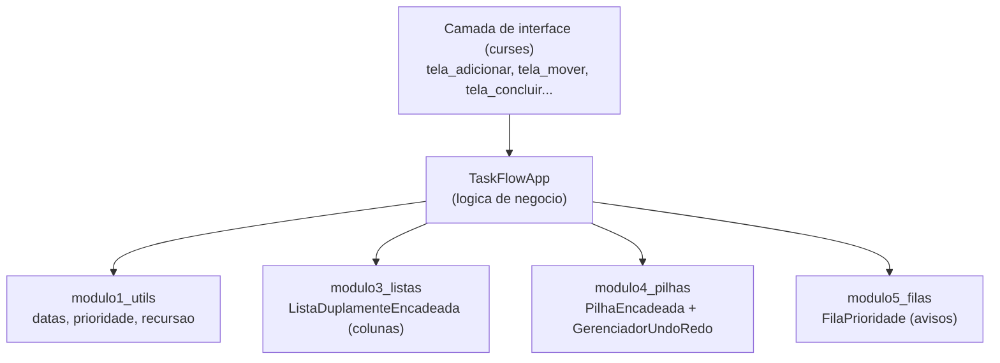

# Arquitetura

## Visão geral

O TaskFlow é uma aplicação de terminal (CLI) local — não tem servidor,
nem banco de dados externo, nem rotas HTTP. Todo o estado vive em memória
enquanto o programa roda.

O sistema é dividido em duas camadas bem separadas:

- **Camada de lógica** (`TaskFlowApp`, dentro de `projeto_final/main.py`):
  contém todas as regras de negócio (adicionar tarefa, mover entre
  colunas, desfazer/refazer, calcular avisos). Não imprime nada na tela
  nem lê teclado diretamente — só recebe dados e devolve resultados.
- **Camada de interface** (funções `tela_*`, também em `main.py`): usa a
  biblioteca `curses` pra desenhar o menu, capturar teclas e mostrar
  mensagens. Ela chama a camada de lógica, mas a lógica nunca chama ela
  de volta.

Essa separação existe pra que a lógica possa ser testada sem precisar
simular um terminal (ver `testes/`), e pra deixar claro, na apresentação,
qual parte do código é "regra do sistema" e qual é "como o usuário vê".

## Componentes e fluxo de dados

Fluxo de uma ação típica (ex.: mover uma tarefa de coluna):

1. `tela_mover` captura o ID da tarefa e a coluna de destino digitados
   pelo usuário.
2. Chama `TaskFlowApp.mover_tarefa(...)`.
3. `TaskFlowApp` tira um snapshot do estado atual e empilha no
   `GerenciadorUndoRedo` (Módulo 4), pra permitir desfazer depois.
4. Remove a tarefa da `ListaDuplamenteEncadeada` (Módulo 3) da coluna de
   origem e insere na coluna de destino.
5. Retorna uma mensagem de resultado, que a interface exibe.

O Módulo 2 (`modulo2_tad`) não está plugado no fluxo do app integrado —
ele existe como comparação didática (TAD com armazenamento estático x
dinâmico), pedida separadamente no roteiro da disciplina.

## Documentação de API

Não se aplica: o TaskFlow não expõe nenhuma API HTTP nem tem
integrações externas — é uma aplicação de terminal que roda inteiramente
na máquina do usuário, sem rotas, endpoints ou requisições de rede. Por
isso não há seção de endpoints/requisições neste projeto.

## Decisões técnicas (ADR)

As decisões de design e suas justificativas estão documentadas
separadamente em [`docs/adr/`](./adr/), uma por arquivo, seguindo o
formato padrão de Architecture Decision Records.
